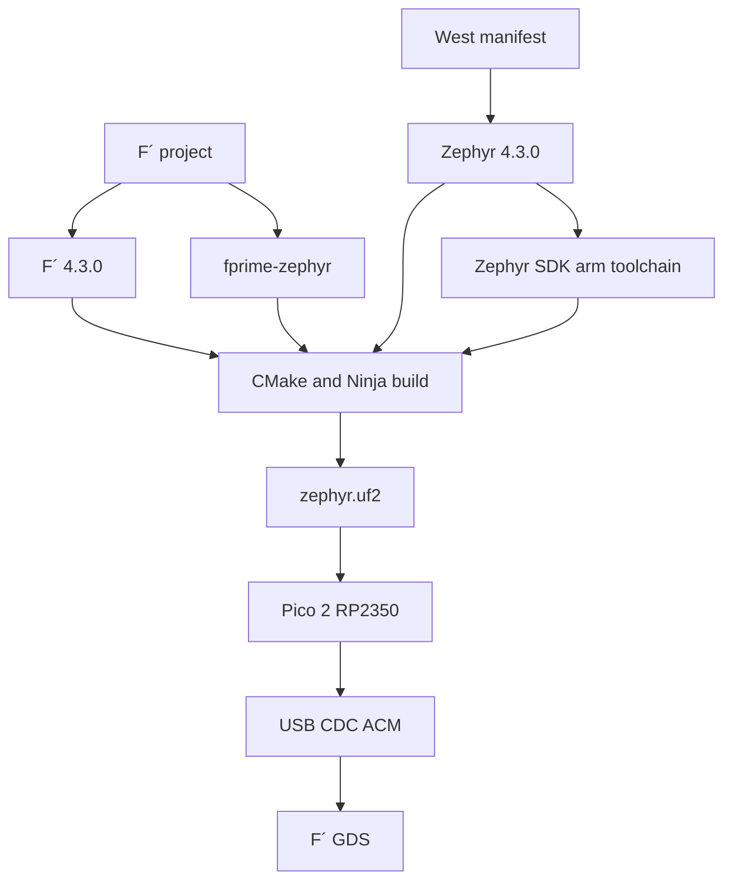

This guide records the working F´ 4.3.0 and Zephyr 4.3.0 bring-up for an official Raspberry Pi Pico 2 using the RP2350 M33 core under WSL2. It covers the development environment, repository layout, West workspace, Zephyr SDK, CMake integration, USB CDC transport, F´ topology changes, memory tuning, UF2 flashing, GDS connection, and the failures encountered along the way.

The final result is a Pico 2 firmware image that boots Zephyr, initializes the F´ topology, communicates with F´ GDS over USB CDC ACM, and accepts commands such as NO_OP. The most important lesson was that successful compilation and USB enumeration did not guarantee a working topology: both rate-group wiring and runtime RAM allocation had to be corrected.

# Working software baseline

| Item | Working version or value |
| - | - |
| Host | WSL2 with Ubuntu 24.04 |
| Python | 3.12.15 virtual environment |
| F´ | 4.3.0 |
| fprime-tools and fprime-gds | 4.3.0 |
| fprime-fpp | 3.3.0 |
| fprime-zephyr | commit 849796d7f5d483b7a9ada2ae5bfb777036856a38 |
| Zephyr | 4.3.0 |
| West | 1.5.0 |
| Zephyr SDK | 0.17.4 |
| SDK toolchain | arm-zephyr-eabi |
| CMake | 3.31.10 from the Python environment |
| Ninja | 1.11.1 |
| Device-tree compiler | 1.7.2 |
| Target | rpi_pico2/rp2350a/m33 |
| USB device | CDC ACM, VID 0028:000F |
| Windows port | COM7 during this bring-up |
| WSL port | /dev/ttyACM0 |
| GDS framing | space-packet-space-data-link |

Python 3.12 was used because it is supported by the selected F´ and Zephyr toolchain. A newer Python version is unnecessary for this baseline and can introduce package-compatibility risk.

# Architecture



F´ supplies the component framework, topology, commands, events, telemetry, and ground system. Zephyr supplies the RTOS kernel, device tree, USB stack, drivers, timers, threads, and embedded build environment. fprime-zephyr provides the F´ OS abstraction implementations and Zephyr-specific components such as ZephyrUartDriver, ZephyrRateDriver, and ZephyrTime.

Unlike F´ on Linux, there is no host process, POSIX UART path, Linux timer component, or effectively unlimited virtual memory on the target. Threads, queues, stacks, communication buffers, and driver state all consume the Pico 2’s finite SRAM.

# Repository layout and Git strategy

```text
fprime-blv-ref/
├── .west/
│   └── config
├── boards/
│   └── <Pico 2 overlay>.overlay
├── FprimeBlvRef/
│   ├── project/config/
│   └── ReferenceDeployment/
├── lib/
│   ├── fprime/                 Git submodule
│   ├── fprime-zephyr/          Git submodule
│   └── zephyr-workspace/       Generated by West, ignored by Git
├── CMakeLists.txt
├── prj.conf
├── settings.ini
└── west.yml
```

F´ and fprime-zephyr are Git submodules pinned to exact commits. The Zephyr source tree and modules under lib/zephyr-workspace are managed by West and should not be staged as embedded Git repositories.

```gitignore
/lib/zephyr-workspace/
```

A fresh clone reproduces the West-managed repositories from west.yml with `west update`. The project tracks west.yml and may track .west/config because they define how the repository locates its manifest.

# Python environment and dependencies

```bash
python3.12 -m venv fprime-venv
source fprime-venv/bin/activate
python -m pip install --upgrade pip
python -m pip install -r lib/fprime/requirements.txt
python -m pip install west patool semver tqdm pyserial
python -m pip install -r lib/zephyr-workspace/zephyr/scripts/requirements.txt
```

patool and semver were required by the Zephyr 4.3 West SDK extension. Installing only West caused ModuleNotFoundError failures for patoolib and then semver.

```bash
which python
python --version
which fprime-util
fprime-util version-check
west --version
cmake --version
ninja --version
dtc --version
python -m pip check
```

Use `fprime-util version-check`; `fprime-util --version` is not the applicable interface.

# West workspace and Zephyr SDK

.west/config identifies the project root as the West workspace and points to west.yml:

```ini
[manifest]
path = .
file = west.yml

[zephyr]
base = ./lib/zephyr-workspace/zephyr
```

West finds this configuration by walking upward from the current directory until it finds .west.

```bash
west update
west packages pip --install

west topdir
west config manifest.path
west config manifest.file
west config zephyr.base
west list zephyr hal_rpi_pico cmsis cmsis_6 picolibc
git -C lib/zephyr-workspace/zephyr describe --tags --exact-match
```

Install the ARM SDK toolchain:

```bash
cd lib/zephyr-workspace/zephyr
west sdk install --toolchains arm-zephyr-eabi
west sdk list
```

The installed SDK was /home/bidat/zephyr-sdk-0.17.4. Running `west zephyr-export` was not required because CMake receives an explicit Zephyr hint inside the West workspace.

# F´ and CMake integration

settings.ini registers fprime-zephyr as a library:

```ini
[fprime]
project_root: .
framework_path: ./lib/fprime
library_locations: ./lib/fprime-zephyr

default_cmake_options: FPRIME_ENABLE_FRAMEWORK_UTS=OFF
                       FPRIME_ENABLE_AUTOCODER_UTS=OFF
```

The top-level CMakeLists.txt loads Zephyr before declaring the project, then loads F´:

```cmake
cmake_minimum_required(VERSION 3.24.2)

list(APPEND BOARD_ROOT "${CMAKE_CURRENT_LIST_DIR}")

if (NOT BUILD_TESTING)
    find_package(
        Zephyr
        HINTS "${CMAKE_CURRENT_LIST_DIR}/lib/zephyr-workspace"
    )
endif()

project(FprimeBlvRef C CXX)

include("${CMAKE_CURRENT_LIST_DIR}/lib/fprime/cmake/FPrime.cmake")
fprime_setup_included_code()

add_fprime_subdirectory("${CMAKE_CURRENT_LIST_DIR}/FprimeBlvRef")
```

The deployment is registered as a Zephyr deployment:

```cmake
register_fprime_zephyr_deployment(
    ${FPRIME_CURRENT_MODULE}
    SOURCES
        "${CMAKE_CURRENT_LIST_DIR}/Main.cpp"
    DEPENDS
        ${FPRIME_CURRENT_MODULE}_Top
)
```

This registration creates the `zephyr` build target used by `fprime-util build zephyr` and adds Main.cpp to Zephyr’s application target.

# Zephyr application configuration

The following settings capture the working bring-up configuration. Keep project-specific peripheral settings alongside them as needed.

```ini
CONFIG_CPP=y
CONFIG_REQUIRES_FULL_LIBCPP=y
CONFIG_CPP_EXCEPTIONS=n
CONFIG_CPP_RTTI=n
CONFIG_COMMON_LIBC_MALLOC=y

CONFIG_DYNAMIC_THREAD=y
CONFIG_DYNAMIC_THREAD_ALLOC=n
CONFIG_DYNAMIC_THREAD_PREFER_POOL=y
CONFIG_DYNAMIC_THREAD_POOL_SIZE=20
CONFIG_DYNAMIC_THREAD_STACK_SIZE=4096
CONFIG_THREAD_STACK_INFO=y
CONFIG_KERNEL_MEM_POOL=y

CONFIG_MAIN_STACK_SIZE=8192
CONFIG_REBOOT=y
CONFIG_RING_BUFFER=y
CONFIG_ASSERT=y

CONFIG_SERIAL=y
CONFIG_UART_INTERRUPT_DRIVEN=y
CONFIG_UART_USE_RUNTIME_CONFIGURE=y
CONFIG_UART_LINE_CTRL=y

CONFIG_USB_DEVICE_STACK_NEXT=y
CONFIG_USBD_CDC_ACM_CLASS=y
CONFIG_CDC_ACM_SERIAL_ENABLE_AT_BOOT=y
CONFIG_CDC_ACM_SERIAL_INITIALIZE_AT_BOOT=y
CONFIG_CDC_ACM_SERIAL_PRODUCT_STRING="F Prime UART Communication"
CONFIG_CDC_ACM_SERIAL_PID=0x000F
CONFIG_CDC_ACM_SERIAL_VID=0x0028

CONFIG_CONSOLE=n
CONFIG_UART_CONSOLE=n
CONFIG_PRINTK=n

CONFIG_GPIO=y
CONFIG_PWM=y
CONFIG_I2C=y
CONFIG_SPI=y
CONFIG_PINCTRL=y

CONFIG_BUILD_OUTPUT_UF2=y
```

The development VID and PID identify the CDC ACM device to the host. They do not configure a physical UART baud rate. The F´ binary channel and Zephyr text console must not share the CDC stream during normal operation because text would corrupt binary CCSDS frames.

# Device-tree overlay

```dts
&zephyr_udc0 {
    status = "okay";

    cdc_acm_uart0: cdc_acm_uart0 {
        compatible = "zephyr,cdc-acm-uart";
        label = "CDC_ACM_0";
    };
};
```

For assertion diagnosis only, the console was temporarily redirected to CDC ACM:

```dts
/ {
    chosen {
        zephyr,console = &cdc_acm_uart0;
        zephyr,shell-uart = &cdc_acm_uart0;
    };
};
```

The chosen override and console options were removed or disabled after debugging.

# F´ configuration overrides

The default F´ task handle was 40 bytes, but fprime-zephyr’s ZephyrTask implementation required 168 bytes. The project registers configuration overrides before the deployment:

```cmake
register_fprime_config(
    CONFIGURATION_OVERRIDES
        "${CMAKE_CURRENT_LIST_DIR}/PlatformCfg.fpp"
        "${CMAKE_CURRENT_LIST_DIR}/CdhCoreConfig.fpp"
        "${CMAKE_CURRENT_LIST_DIR}/ComCcsdsConfig.fpp"
        "${CMAKE_CURRENT_LIST_DIR}/DataProductsConfig.fpp"
        "${CMAKE_CURRENT_LIST_DIR}/FileHandlingConfig.fpp"
    INTERFACE
)
```

PlatformCfg.fpp contains:

```fpp
constant FW_TASK_HANDLE_MAX_SIZE = 192
```

Verify the generated value:

```bash
rg -n 'FW_TASK_HANDLE_MAX_SIZE' build-fprime-automatic-zephyr
```

All active-component stack sizes were changed to 4 KiB to exactly match CONFIG_DYNAMIC_THREAD_STACK_SIZE=4096. Final priorities were between 1 and 12. Zephyr treats lower numeric values as higher priorities, unlike the common Linux F´ convention.

# Deployment changes from Linux to Zephyr

The deployment was initially generated with `fprime-util new --deployment`. Linux-oriented instances were replaced as follows:

| Linux-oriented component | Zephyr component |
| - | - |
| Svc.LinuxTimer | Zephyr.ZephyrRateDriver |
| Drv.LinuxUartDriver | Zephyr.ZephyrUartDriver |
| Svc.ChronoTime | Zephyr.ZephyrTime |

TopologyState carries the Zephyr device and baud rate plus imported subtopology state:

```cpp
struct TopologyState {
    const struct device* uartDevice;
    U32 baudRate;

    CdhCore::SubtopologyState cdhCore;
    ComCcsds::SubtopologyState comCcsds;
    DataProducts::SubtopologyState dataProducts;
    FileHandling::SubtopologyState fileHandling;
};
```

The setup sequence is:

```cpp
initComponents(state);
setBaseIds();
connectComponents();
regCommands();
configComponents(state);
configureTopology();
readParameters();
loadParameters();
startTasks(state);

FW_ASSERT(state.uartDevice != nullptr);
comDriver.configure(state.uartDevice, state.baudRate);
```

A 100 ms base period with divisors 1, 2, and 4 produces 10 Hz, 5 Hz, and 2.5 Hz groups, despite the older instance names containing 1Hz, 0_5Hz, and 0_25Hz.

# Critical topology wiring

The UART driver connects to ComCcsds as follows:

```fpp
connections Communications {
    comDriver.allocate ->
        ComCcsds.commsBufferManager.bufferGetCallee

    comDriver.deallocate ->
        ComCcsds.commsBufferManager.bufferSendIn

    comDriver.$recv ->
        ComCcsds.comStub.drvReceiveIn

    ComCcsds.comStub.drvReceiveReturnOut ->
        comDriver.recvReturnIn

    ComCcsds.comStub.drvSendOut ->
        comDriver.$send

    comDriver.ready ->
        ComCcsds.comStub.drvConnected
}
```

A missing rate-group connection was a major functional bug. The required line is:

```fpp
rateGroupDriver.CycleOut[Ports_RateGroups.rateGroup_1Hz] ->
    rateGroup_1Hz.CycleIn
```

Without it, the rate group never invoked the UART driver, command dispatcher, communication queue, aggregator, or telemetry service.

```fpp
rateGroup_1Hz.RateGroupMemberOut[0] -> comDriver.schedIn
rateGroup_1Hz.RateGroupMemberOut[1] -> CdhCore.cmdDisp.run
rateGroup_1Hz.RateGroupMemberOut[2] -> ComCcsds.comQueue.run
rateGroup_1Hz.RateGroupMemberOut[3] -> ComCcsds.aggregator.timeout
rateGroup_1Hz.RateGroupMemberOut[4] -> CdhCore.tlmSend.Run
```

# Main program and USB readiness

F´ headers must precede Zephyr headers. Including Zephyr first caused its EMPTY macro to collide with Os::Queue::Status::EMPTY.

```cpp
#include <FprimeBlvRef/ReferenceDeployment/Top/ReferenceDeploymentTopology.hpp>
#include <Os/Os.hpp>

#include <zephyr/device.h>
#include <zephyr/drivers/uart.h>
#include <zephyr/kernel.h>
```

Main obtains the CDC ACM device and waits for the host to assert DTR:

```cpp
int main() {
    Os::init();

    const struct device* uartDevice =
        DEVICE_DT_GET(DT_NODELABEL(cdc_acm_uart0));

    if (!device_is_ready(uartDevice)) {
        return -1;
    }

    uint32_t dtr = 0;
    while (dtr == 0) {
        uart_line_ctrl_get(uartDevice, UART_LINE_CTRL_DTR, &dtr);
        k_sleep(K_MSEC(100));
    }

    FprimeBlvRef::TopologyState state{};
    state.uartDevice = uartDevice;
    state.baudRate = 115200;

    FprimeBlvRef::setupTopology(state);
    FprimeBlvRef::startRateGroups();
    return 0;
}
```

# Memory tuning that made startup succeed

The first build overflowed RP2350 SRAM at link time. After static memory was reduced enough to link, topology setup still failed because runtime allocations exhausted the remaining libc heap.

The working bring-up reductions were:

- Dynamic thread stack size reduced from 8192 to 4096 bytes.

- Dynamic thread pool reduced from 25 to 20 entries after counting 18 generated thread starts.

- Every active FPP stack changed to exactly 4 KiB.

- Component queue depths reduced for initial bring-up.

- ComQueue event depth reduced from 50 to 5; telemetry and file depths remained 1.

- Data Products buffer accumulator reduced to two buffers.

- Data Products buffer manager reduced to two 512-byte buffers.

```fpp
module BufferAccumulator {
    constant allocatorId = 301
    constant maxNumBuffers = 2
}

module BuffMgr {
    constant dpBufferStoreSize = 512
    constant dpBufferStoreCount = 2
    constant dpBufferManagerId = 300
}
```

Runtime failures identified during this process:

1. Svc::ComQueue asserted at ComQueue.cpp line 115 because malloc returned nullptr.

2. After reducing communication and thread memory, ComQueue succeeded.

3. DataProducts.dpBufferManager then asserted while requesting 5,640 bytes with allocator ID 300.

4. Reducing the Data Products pool allowed topology setup to complete.

These are bring-up values, not validated flight sizing. Increase them only after measuring peak traffic, queue high-water marks, and task stack high-water marks.

# Build and flash

Initial generation or platform change:

```bash
fprime-util generate -DBOARD=rpi_pico2/rp2350a/m33 zephyr
```

Normal build:

```bash
fprime-util build zephyr
```

Clean regeneration when necessary:

```bash
fprime-util purge zephyr -f
fprime-util generate -DBOARD=rpi_pico2/rp2350a/m33 zephyr
fprime-util build zephyr
```

The output is `build-fprime-automatic-zephyr/zephyr/zephyr.uf2`.

To flash, enter BOOTSEL mode, copy the UF2 to the RPI-RP2 mass-storage volume, and wait for reboot. The drive disappearing after the copy is expected: the ROM bootloader has rebooted into the application, which then enumerates as CDC ACM.

# WSL2 USB and serial checks

```bash
lsusb
python -m serial.tools.list_ports -v
```

The working device appeared as VID 0028:000F at /dev/ttyACM0. If the port returns Permission denied:

```bash
sudo usermod -aG dialout "$USER"
```

Restart the WSL session so the group membership applies.

```python
import serial

with serial.Serial(
    "/dev/ttyACM0",
    115200,
    timeout=1,
    write_timeout=1,
) as device:
    print("Opened:", device.is_open)
```

The same board worked with PROVES firmware under WSL, which helped rule out the cable, board, Windows forwarding, and WSL serial transport.

# Running F´ GDS

The embedded build does not produce a host executable under deployment/bin, so GDS must not launch the flight application. Use `-n` and supply the Zephyr dictionary explicitly:

```bash
fprime-gds \
  -n \
  --dictionary "$PWD/build-artifacts/zephyr/fprime-zephyr-deployment/dict/ReferenceDeploymentTopologyDictionary.json" \
  --communication-selection uart \
  --uart-device /dev/ttyACM0 \
  --uart-baud 115200 \
  --framing-selection space-packet-space-data-link \
  --log-to-stdout \
  --log-level-gds DEBUG
```

The selected framing matches the ComCcsds chain containing SpacePacketFramer, SpacePacketDeframer, TcDeframer, TmFramer, and ComAggregator.

| Error | Meaning and fix |
| - | - |
| deployment/bin does not exist | GDS tried to launch a host binary; use -n and an explicit dictionary |
| build-artifacts/Linux does not exist | GDS selected Linux artifacts; use the Zephyr dictionary |
| serial port not valid | Pico was unplugged or not attached to WSL |
| Permission denied | User lacked access to /dev/ttyACM0 |
| Uplink failed after retries | GDS could not write the serial port |
| Writes succeed but no responses | Firmware transport opened, but topology setup or rate-group processing was not running |

After the final flash, NO_OP produced the expected command response and events.

# Diagnostic sequence used

1. Confirmed USB enumeration in Windows and WSL.

2. Opened /dev/ttyACM0 directly with pyserial.

3. Sent a raw `BLV CDC READY` marker with uart_poll_out, proving USB CDC transmit independently of F´.

4. Added markers before and after setupTopology. Receiving only BEFORE SETUP localized the fault to topology setup.

5. Added S0 through S10 markers around setup phases.

6. Temporarily routed the Zephyr console to cdc_acm_uart0 and enabled verbose assertions.

7. Captured the ComQueue allocation assertion.

8. Reduced thread, queue, and communication memory.

9. Captured the Data Products BufferManager allocation assertion.

10. Reduced the Data Products pool and completed setup.

11. Removed all raw markers and disabled the CDC console before returning to binary GDS traffic.

This separated USB transport, topology initialization, scheduling, framing, and GDS into independently testable layers.

# Failure reference

| Failure | Root cause | Fix |
| - | - | - |
| patoolib or semver missing | West SDK extension dependencies absent | Install patool and semver plus Zephyr script requirements |
| Embedded repository warnings | West-managed repositories staged by Git | Remove them from the index and ignore lib/zephyr-workspace |
| Handle size not large enough, 168 <= 40 | Default task handle too small for ZephyrTask | Override FW_TASK_HANDLE_MAX_SIZE to 192 |
| Hexadecimal digit separators rejected | Insufficient C++ language level | Enable the required C++ standard |
| cdc_acm_uart0 symbol missing | CDC ACM node absent from effective device tree | Add the USB CDC overlay |
| RAM overflow at link time | Static stacks, pools, handles, and buffers exceeded SRAM | Reduce stacks, pool count, queues, and buffers |
| EMPTY compilation error | Zephyr macro collided with F´ Queue enum | Include F´ headers before Zephyr headers |
| Only BEFORE SETUP appeared | Topology setup asserted | Add phase markers and temporary console diagnostics |
| ComQueue.cpp line 115 assertion | Communication queue malloc returned nullptr | Reduce memory usage and queue depths |
| BufferManager assertion, ID 300 | Data Products pool exceeded remaining heap | Reduce Data Products size and count |
| UF2 storage volume disappeared | Bootloader rebooted after successful copy | Expected; look for the CDC ACM port |
| GDS opened but showed no traffic | Missing rate-group connection plus setup assertions | Restore CycleOut-to-CycleIn and fix memory sizing |

# Final verification checklist

- [ ] fprime-util version-check reports F´ 4.3.0 tools and submodule.

- [ ] west list reports Zephyr 4.3.0 and required modules.

- [ ] west sdk list reports SDK 0.17.4 with arm-zephyr-eabi.

- [ ] CONFIG_DYNAMIC_THREAD_STACK_SIZE is 4096.

- [ ] CONFIG_DYNAMIC_THREAD_POOL_SIZE is 20.

- [ ] Every active FPP stack is exactly 4 KiB.

- [ ] cdc_acm_uart0 exists in the effective zephyr.dts.

- [ ] Console, UART console, and printk are disabled for normal GDS operation.

- [ ] RateGroupDriver CycleOut is connected to the communications rate group CycleIn.

- [ ] zephyr.uf2 builds and flashes successfully.

- [ ] Pico re-enumerates as /dev/ttyACM0.

- [ ] pyserial opens the port without permission errors.

- [ ] GDS uses -n, the Zephyr dictionary, UART, and space-packet-space-data-link framing.

- [ ] NO_OP returns a command response.

- [ ] Events and telemetry appear without framing errors.

# Reference repositories

- [fprime-community fprime-zephyr](https://github.com/fprime-community/fprime-zephyr)

- [NASA F´](https://github.com/nasa/fprime)

- [OSSF LED tutorial PROVES reference](https://github.com/Open-Source-Space-Foundation/led-tutorial-proves-core-reference)

- [OSSF PROVES core reference](https://github.com/Open-Source-Space-Foundation/proves-core-reference)

- [LucaLanzi fprime billee rcm](https://github.com/LucaLanzi/fprime-billee-rcm)

The LED tutorial was especially useful as a minimal CdhCore plus ComCcsds reference. The full PROVES project remains useful for studying a larger flight configuration, MCUBoot, filesystems, and firmware update workflows.

# Recommended next steps

1. Commit the known-working state, including submodule pins, west.yml, prj.conf, the overlay, configuration overrides, and deployment source—but not West-managed trees or build artifacts.

2. Record the working ELF memory report.

3. Rename rate groups to their actual 10 Hz, 5 Hz, and 2.5 Hz frequencies.

4. Add one custom component at a time and verify memory, startup, commands, and telemetry after each addition.

5. Measure task stack and queue high-water marks before changing resource sizes.

6. Increase communication and Data Products buffers only from measured requirements.

7. Create the custom RP2350 board definition after the official Pico 2 baseline remains reproducible.

8. Add MCUBoot only when signed images, rollback, or in-field updates become requirements; it is not needed for basic UF2 development flashing.
